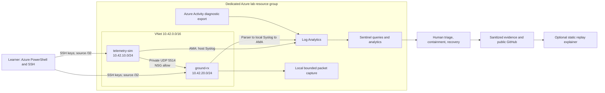

# Architecture and scenario contract

Status: proposed design, not implemented. Names and address ranges below are lab defaults; check conflicts before deployment.

The diagram and JSON contract describe the Python baseline. A future NASA cFS extension would use binary telemetry, a separate command direction and configuration-specific ports. Such integration is not implemented; do not mix those assumptions with the baseline port/schema.

## Components and boundaries

- One resource group, region, VNet, workspace, and Sentinel instance; two small supported Ubuntu LTS VMs selected for quota/agent support. Pin tested image, tool, and API versions in the implementation.
- `telemetry-sim` represents a remote telemetry source, not a spacecraft. `ground-rx` represents a ground ingestion service. The simulated IP link is not an RF or space protocol model.
- Management plane: Azure PowerShell/portal under the learner's account. Guest plane: SSH using local keys and a named Linux operator. Inventory both identity systems separately; similar names do not establish that two events have the same actor.
- For the short lab, each VM gets an explicit Standard public IP for outbound access, with inbound SSH restricted to the learner's current IPv4 `/32`; password and root SSH disabled. Telemetry is private only. Deny all other unsolicited ingress, including public UDP. Document this lab convenience and the production alternative of private administration/managed egress.
- Do not rely on implicit outbound access. Explicit egress is required for predictable bootstrap and AMA operation under current Azure networking defaults. Limit outbound ports to documented bootstrap/monitoring needs where feasible; any broad bootstrap egress is an explicit gap, not a claim of restricted production egress. [Azure outbound documentation](https://learn.microsoft.com/en-us/azure/virtual-network/ip-services/default-outbound-access)
- NSGs need explicit cross-subnet denies ahead of default VNet allows. Permit simulator private source → receiver private address UDP/5514; permit only the documented management path; deny other inter-subnet initiation in each direction. NSGs are stateful; verify new connections when testing a rule change. Keep DNS, time synchronization, required platform/agent access, and recovery administration working. [NSG behavior](https://learn.microsoft.com/en-us/azure/virtual-network/network-security-groups-overview)

## Telemetry pipeline

Python standard-library sender/receiver, systemd services, rsyslog, tcpdump, AMA, one DCR, Log Analytics, Sentinel. Avoid a custom ingestion API or extra collector VM.

The receiver validates a bounded JSON packet, records receive time and observed source, and emits a compact structured message into `local4` Syslog. Collect that facility plus necessary `auth`/`authpriv` events at selected severities, with an explicit volume budget. Verify an actual sudo/auth event on the chosen image rather than assuming journal messages reach Syslog. DCR association and destination must be checked on both VMs. UDP payloads are not automatically parsed by AMA. [AMA Syslog collection](https://learn.microsoft.com/en-us/azure/azure-monitor/vm/data-collection-syslog)

Use `Syslog` for host/application events, `Heartbeat` for agent health, and `AzureActivity` for Azure control-plane operations. Activity export is configured at subscription scope and filtered to lab resources in queries; preserve unrelated existing diagnostics. It does not supply Entra sign-in or guest process telemetry. Prefer a direct diagnostic setting if the connector/policy wizard adds unnecessary scope. [Azure Activity export](https://learn.microsoft.com/en-us/azure/azure-monitor/essentials/activity-log)

Capture a short, filtered pcap on the receiver to inspect accepted UDP traffic. A packet denied before reaching its NIC will not appear there. For blocked paths use source-side probes, effective NSG rules, and Network Watcher diagnostics; a timeout alone does not establish which control denied it. No claim of a deployed IDS or full network sensor platform. New NSG flow logs are unavailable; VNet flow logs are an optional future extension. [Network Watcher flow-log guidance](https://learn.microsoft.com/en-us/azure/network-watcher/nsg-flow-logs-overview)

## Stable event contract for separate agents

Define one versioned schema before application and detection work diverge:

| Field | Meaning |
|---|---|
| `schema_version` | Initially `1` |
| `run_id`, `scenario_id` | Unique execution identifier and scenario label; not evidence of maliciousness |
| `event_id` | Unique observed event ID |
| `event_time_utc`, `observed_time_utc` | Sender-declared time and receiver-observed time; keep separate |
| `mission_id`, `asset_id`, `sequence` | Synthetic mission, sender-declared asset, integer packet sequence |
| `event_type`, `outcome`, `reason` | Receiver-derived classification and outcome |
| `src_ip`, `dst_ip`, `dst_port`, `protocol` | Observed network context where available |
| `source_kind` | `live_lab` or `fixture`; record data provenance |

Keep mission-window configuration in a small versioned file with UTC start/end and approved maintenance intervals. It is scenario context, not a real scheduling system. Use an agreed Syslog prefix and JSON payload to make KQL parsing stable. Receiver caps packet size, handles invalid JSON without crashing, and bounds state/log growth. Generator caps rate, duration, and destination to the owned lab.

Detection logic must use observed behavior and time windows, not `scenario_id`, `run_id`, a fixture's expected-answer label, or a fabricated `is_attack` flag. Runtime IDs only filter an evaluation. Sender-declared identity is untrusted: an IP allow and duplicate counter do not provide cryptographic spacecraft authentication. Plain UDP integrity/confidentiality and production command authentication are explicit gaps.

## Two required exercises and one optional extension

S1 must include the bounded captured-message replay in [the SPARTA mapping](sparta-mapping.md), not just randomly duplicated generator output. Preserve the distinction between a replay behavior, a benign retransmission and a parser error. Mapping remains planned until the run has evidence.

| Scenario | Controlled stimulus and observations | Analyst outcome |
|---|---|---|
| S1: Mission telemetry anomaly | Normal low-rate packets, malformed packets, and repeated sequence numbers; benign retry lookalike; short mission window. Capture actual network packets and parser events. | D1 KQL flags a bounded anomaly pattern. Triage retry vs misconfiguration vs escalation; tune a threshold against labeled test cases. Do not equate duplicate packets with a proven attack. |
| S2: Unexpected privileged change | Save effective NSG configuration; make a reversible lab-only internal source/port rule change and one known guest sudo action outside an approved window. Never expose administration to the whole internet. Record actual Activity/Syslog events and before/after configuration. | D2 KQL flags the relevant Azure write. Pivot through caller, resource, time, host action, network policy and change ledger. Compare authorized maintenance to unexplained activity; document correlation limits. |
| S3, optional: Telemetry silence | Stop the sender briefly during a scheduled mission; verify agent heartbeat and receiver health remain visible; restore sender. Repeat outside the mission window as the negative case. | D3 KQL detects missing expected telemetry with a baseline/mission schedule and ingestion-delay allowance. Distinguish service outage, ingestion delay and monitoring failure. Record watch handoff and recovery evidence. |

Test D1 and D2 as KQL queries. Deploy at least D1 as a Sentinel scheduled analytic and demonstrate an actual alert/incident; scheduling D2 is optional. The required third query is the S2 hunt described below. D3 is an optional extension, not part of the minimum release. Mission-watch practice runs during S1 even if S3 is omitted. Record event time, ingestion time, query lookback/frequency, and observed time-to-detection; do not promise immediate alerts. Use fresh time windows for live runs and explicit fixed windows for historical replay.

The hunt reuses S2: **Were privileged configuration changes made outside documented maintenance, and do independent records support the stated explanation?** Record hypothesis, scope, KQL, results, counter-evidence and confidence. A controlled network port probe can support a T1046 discussion if actually executed; benign administrative actions alone do not establish T1078 adversary activity. Mapping requires behavior-specific justification. [MITRE T1046](https://attack.mitre.org/techniques/T1046/), [MITRE T1078](https://attack.mitre.org/techniques/T1078/)

## Response and evidence

For the main case, preserve short log exports/configuration/pcap before changing the lab when safe. Record UTC timestamps and hashes of raw files locally. Keep public sanitized derivatives separate, hash them separately, and describe redactions; hashes are integrity checks, not proof of immutable storage or full chain of custody.

The learner decides whether to isolate a source, revert the test NSG rule, or stop a service, and states the mission impact. Use the smallest reversible intervention. Do not isolate the analyst's only management path or agent egress accidentally. Test a new connection, restore the baseline, verify telemetry and agent health, and update the playbook with one gap encountered. No autonomous cloud containment.

Public evidence metadata must include: scenario/run, source and provenance, event/collection timestamps, command or query, tool/schema versions, expected and observed result, hash, redaction description, and associated control/test IDs. Do not publish unreviewed raw logs or packet captures.
