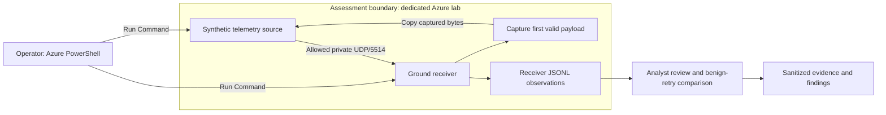

# Ground Station Defense Lab — Security Assessment Package

**Educational authorization-package exercise · Public synthetic data · No authorization granted**

| Document control | Value |
|---|---|
| Package identifier | GSDL-SAP-001 |
| Prepared | 2026-11-16 |
| System owner / assessor | cooke-labs; self-assessed, without independent assessor |
| Assessment scope | One captured-message replay against a synthetic ground receiver |
| Evidence status | Live Azure exercise and receiver policy comparison |
| Decision status | No authorizing official, signed decision, or ATO |

## Executive summary

This project asks a specific security question: **can a ground receiver distinguish new telemetry from a previously accepted message that has been resent over an allowed network path?** Two Azure Linux VMs represent a telemetry source and a ground ingestion service. The exercise captures a synthetic message, deliberately replays its bytes, records the receiver's observations, and compares the result with a benign retry.

The assessment is designed to connect an observable attack behavior to engineering decisions and residual risk. Network segmentation limits which hosts and ports can communicate. It cannot distinguish legitimate telemetry from replay when both use the permitted UDP path. Receiver-side duplicate detection can expose repeated data, but strong prevention also needs authenticated messages and trustworthy freshness checks.

The deliverable follows the shape of an authorization package: system description and selected control statements, assessment procedures and results, evidence, and a plan of action and milestones. NIST SP 800-37 Rev. 2, Task R-1, describes assembling plans, assessment reports, remediation plans, and supporting evidence for an authorization decision. This educational package omits institutional approvals and cannot grant authority to operate. [NIST RMF, Rev. 2](https://csrc.nist.gov/pubs/sp/800/37/r2/final)

**Assessment conclusion.** The receiver accepted all five copies in the original replay burst. The local D1 analysis generated one alert, timestamped at the third duplicate in that burst. One documented retry was also accepted and stayed below the alert threshold. With duplicate rejection enabled and the captured message already seen in the new process, the receiver logged five rejected copies and accepted three fresh sequences. Origin authentication and restart-safe freshness remain open risks.

## 1. System security plan — bounded scope

| Boundary element | Description |
|---|---|
| Hosting | Azure West US 2; dedicated `rg-ground-station-lab` resource group |
| Telemetry source | `gsdl-sim-vm`, Ubuntu, simulator subnet `10.42.10.0/24` |
| Ground receiver | `gsdl-ground-vm`, Ubuntu, receiver subnet `10.42.20.0/24` |
| Data path | Private UDP/5514 carrying small synthetic JSON messages |
| Management | Local Azure PowerShell and Azure Run Command; no public inbound SSH rule |
| Egress | Explicit public IPs for outbound access; broad egress is a documented gap |
| Assessment records | Receiver JSONL, captured payload, sender record, analysis output and evidence manifest |
| Excluded | RF, spacecraft flight software, telecommands, real mission data, CUI, operational systems |
| Monitoring limitation | This release assesses local application records; no deployed Sentinel ingestion or scheduled analytic is claimed |

The system processes only invented mission identifiers and telemetry. Confidentiality, integrity, and availability impacts are limited to this disposable lab. Integrity is the principal concern because repeated observations could distort a consumer's view of mission state. The lab assigns no formal FIPS 199 categorization or FedRAMP baseline.

The owner is responsible for Azure access, guest configuration, application code, test authorization, evidence review and cleanup. Underlying cloud operation belongs to the provider; no inherited FedRAMP controls are asserted without an applicable authorization package and responsibility matrix. IaC and lifecycle commands support reproducibility. Deleting compute destroys guest-only evidence, so evidence must be exported first.

## 2. Threat and SPARTA mapping

| Field | Assessment interpretation |
|---|---|
| Technique | **EX-0001 — Replay**, Execution tactic |
| Official reference | [Aerospace SPARTA EX-0001](https://sparta.aerospace.org/technique/EX-0001/) |
| Source checked | 2026-11-16; official page reports last modification 2026-08-06 |
| Relationship | Behavioral analogue; deliberate reuse of captured synthetic telemetry |
| Attacker precondition | Operator controls the owned simulator and can resend its captured payload over the allowed path |
| Observable behavior | The receiver records a repeated source IP, mission, asset and sequence key. Matching SHA-256 fingerprints independently support exact payload reuse. |
| Attribution limit | Duplicate records alone cannot distinguish adversarial replay from a legitimate retry |
| Context gap | No RF link, spacecraft bus, command execution or spacecraft effect is exercised |

The receiver classifies duplicates by observed source IP, sender-declared mission, asset and sequence. D1 groups those duplicate events by source IP, mission and asset, and flags the third duplicate within ten seconds. Payload SHA-256 values independently corroborate that captured and replayed bytes match. A receiver outcome of `rejected` records its acceptance-policy decision. A downstream mission consumer and spacecraft effects are outside the assessed boundary.

Duplicate state exists only in the running receiver process. A prevention-mode test must first send a baseline message into that process, then replay that message. After restart, an old captured message presented first can be accepted; changing a declared identity or sequence can also evade this duplicate check. These are residual risks recorded in P01/P02, not completed anti-replay protections.

SPARTA EX-0001 describes captured traffic being sent again to provoke repeated processing. This lab tests that behavior on an IP telemetry receiver. It does not claim either Command Packets or Bus Traffic Replay sub-technique. The official technique links authentication and relay/replay protection countermeasures, including [**CM0031 — Authentication**](https://sparta.aerospace.org/countermeasures/CM0031) and [**CM0033 — Relay Protection**](https://sparta.aerospace.org/countermeasures/CM0033). Exact titles were checked against the official countermeasure pages/catalog on 2026-11-16. These inform proposed mitigation; they are not implementations demonstrated by this unauthenticated UDP lab. [Official technique](https://sparta.aerospace.org/technique/EX-0001/), [countermeasure catalog](https://sparta.aerospace.org/countermeasures/SPARTA)

## 3. Selected control statements and assessment approach

The following are selected NIST SP 800-53 Rev. 5 relationships, not complete control satisfaction. FedRAMP uses detailed requirements, enhancements and parameters beyond these examples. The [broader control reference](control-map.md) records the project's baseline research; this smaller assessment makes no FedRAMP authorization or compliance claim. [NIST control catalog](https://csrc.nist.gov/pubs/sp/800/53/r5/upd1/final)

| Control | Selected implementation / procedure | Evidence required | Present result and gap |
|---|---|---|---|
| CM-2 Baseline Configuration | Keep Bicep and application source in Git; associate deployed version with the run | Source digest, deployment result, sanitized inventory | Evidence records the tested application source hash and repeatable infrastructure definitions. |
| SC-7 Boundary Protection | Inspect configured subnet NSGs and test allowed private telemetry | Configured rules and a receiver-observed permitted packet | Configuration and packet evidence cover the allowed path. Prohibited paths and egress remain open in P05. |
| AU-12 Audit Record Generation | Receiver records observed time, source, classification and message fingerprint | JSONL covering baseline, replay and recovery | Application records cover the observed cases. P04 tracks centralized retention and integrity. |
| AU-6 Audit Record Review, Analysis, and Reporting | Analyst compares sequence keys, fingerprints and the sender timeline | Local analysis output and triage note with benign alternative | The analyst correlated accepted duplicates with the bounded sender actions and compared the retry. |
| SI-4 System Monitoring | Detect duplicate telemetry from receiver observations | Positive replay and benign-retry results | D1 alerted once for the replay burst and zero times for the isolated retry. The analysis was run on local logs. |
| IR-4 Incident Handling | Preserve records, let the bounded replay end, change receiver policy and verify fresh telemetry | Response decision and recovery observations | Scope is exercise response and recovery. |
| SI-10 Information Input Validation | Exercise malformed input and retain receiver availability | Negative-test output and a subsequent valid packet | Three loopback tests passed on the simulator, including the malformed-input case. |

### FedRAMP relationship: baseline membership versus evidence

Source checked 2026-11-16: the current FedRAMP Rev5 **FRC-CSF-BSL** Class C control list explicitly includes each base control below. This verifies membership in that published list only; this lab has no certification class or FedRAMP authorization. Required enhancements and organization-defined parameters require separate treatment. No parameter value or inherited control is inferred from this small exercise. [Official FedRAMP Rev5 baseline and parameter requirements](https://www.fedramp.gov/2026/providers/rev5/rules/fedramp-certification/#fedramp-rev5-baselines)

| Base control | Published Class C list | Lab evidence status | Coverage limit |
|---|---|---|---|
| CM-2 | Included as CM-02 | Infrastructure records and tested source digest | Partial baseline configuration evidence |
| SC-7 | Included as SC-07 | NSG configuration and permitted UDP delivery | Selected boundary only; enhancements unassessed |
| AU-12 | Included as AU-12 | Timestamped receiver JSONL | Application source only |
| AU-6 | Included as AU-06 | Local D1 output and analyst timeline | Single exercise; ongoing review unassessed |
| SI-4 | Included as SI-04 | Retry and replay comparison | Local batch analysis |
| IR-4 | Included as IR-04 | Exercise response decision and recovery check | Organizational incident program unassessed |
| SI-10 | Included as SI-10 | Loopback malformed-input test | Selected parser checks only |

FedRAMP's current Rev5 guidance relates AU-6 review to its Vulnerability Detection and Response rules and IR-4 handling to Incident Evaluation and Communication rules. The local review and response exercise illustrate only a small part of those responsibilities. Retention, review frequency, incident notification and remediation commitments are not claimed as satisfied. [Official Rev5 control guidance](https://www.fedramp.gov/2026/reference/rev5-control-guidance/)

## 4. Security assessment report

### Test results

Both hosts ran Python 3.12.3. The sender used private UDP/5514, with one-second spacing within each multi-packet command. The replay command paused 11 seconds before transmission to separate the burst from the benign retry. The receiver was bounded to 100 datagrams and 1,100 seconds per process.

| Test | Acceptance criterion | Observed result |
|---|---|---|
| T01 Baseline | Record five fresh sequences and capture the first valid message | **Pass.** Sequences 1–5 accepted over the allowed path. [Receiver baseline](../evidence/public/replay-20261116-b/baseline/events.jsonl) |
| T02 Replay | Receive five copies with the captured fingerprint and produce a D1 alert | **Pass for detection; prevention gap observed.** Five copies matched the capture and were logged as accepted duplicates. D1 produced one alert. The file includes the earlier six baseline observations. [Receiver events](../evidence/public/replay-20261116-b/attack/events.jsonl), [D1 output](../evidence/public/replay-20261116-b/attack/analysis.json) |
| T03 Benign retry | An isolated deliberate retry appears as one duplicate and stays below threshold | **Pass.** One accepted duplicate with the same fingerprint, zero alerts. [Baseline D1 output](../evidence/public/replay-20261116-b/baseline/analysis.json) |
| T04 Input validation | Reject the selected malformed datagram and still accept a later valid datagram | **Pass in loopback.** The simulator ran the malformed-input test and two other cases using real loopback UDP sockets. General parser resilience and live cross-subnet malformed input remain unassessed. [Test output](../evidence/public/replay-20261116-b/test-results.txt) |
| T05 Response and recovery | With duplicate rejection enabled, reject all five copies after seeding and accept three fresh sequences | **Pass within the seeded receiver session.** One seed accepted, five duplicates rejected, and sequences 100–102 accepted. D1 still reported one alert. [Receiver events](../evidence/public/replay-20261116-b/mitigated/events.jsonl), [D1 output](../evidence/public/replay-20261116-b/mitigated/analysis.json) |
| T06 Cost cleanup | Export evidence and verify the resource group contains zero VMs, disks, NICs, public IPs and shutdown schedules | **Pass.** All five compute-related resource counts were zero after export. [Post-exercise inventory](../evidence/public/replay-20261116-b/cleanup.json) |

### Analyst timeline and decision

| UTC on 2026-11-17 | Evidence and decision |
|---|---|
| 02:13:56–02:14:00 | The receiver accepted five fresh messages and one intentional benign retry of sequence 1. The retry had the same fingerprint as the original message and even used a different UDP source port. |
| 02:14:45–02:14:49 | The simulator deliberately replayed five copies of the captured sequence 1. The receiver accepted each and logged it as a duplicate. The third duplicate, observed at 02:14:47.958, triggered D1 in the later batch analysis. |
| Between phases | The local controller stopped after transmission. The recovery procedure exported the existing attack logs, then continued with the mitigation phase using the same run ID and application source. |
| 05:02:03–05:02:09 | A fresh receiver process accepted the old payload as its seed, rejected the five following copies, and accepted three fresh messages. The seed acceptance exposes the restart gap. |

The repeated sequence key and matching fingerprints support byte reuse. Both properties also appeared in the documented benign retry. The five copies in roughly four seconds differed from the isolated comparison retry and justified investigating whether sender behavior matched expected retry policy. The operator procedure and sender log establish deliberate transmission within the exercise. In ordinary triage, an analyst would check retry configuration, sender health and operator activity before attributing intent. The chosen response kept the allowed telemetry path open and changed the receiver policy for the second phase. Rejection is the receiver's logged policy decision. With no downstream mission consumer in scope, mission-state effects remain hypothetical.

### Evidence register

| Evidence ID | Record |
|---|---|
| E01 | [Run metadata](../evidence/public/replay-20261116-b/run.json) and [initial controller](../scripts/Invoke-ReplayExercise.ps1) |
| E02 | [First valid received datagram](../evidence/public/replay-20261116-b/baseline/received.bin), recorded as exact application bytes with no packet headers |
| E03 | [Sender ledger](../evidence/public/replay-20261116-b/sender.jsonl) and phase-specific receiver logs linked above |
| E04 | Phase-specific D1 output and the [application source](../app/telemetry_lab.py) for reproducing it |
| E05 | Analyst timeline and bounded response above |
| E06 | [Public SHA-256 manifest](../evidence/public/replay-20261116-b/manifest.json), [post-exercise inventory](../evidence/public/replay-20261116-b/cleanup.json), [network deployment](../evidence/public/network-2026-11-13.md) and [prior compute deployment and cleanup](../evidence/public/compute-cleanup-2026-11-14.md) |

The public evidence contains reviewed synthetic records. Hashes detect changes relative to a known digest. Collection authenticity and independent custody remain unassessed. Sender timestamps and asserted asset identity remain untrusted.

## 5. Plan of action and milestones

All items below are **open**. The owner is cooke-labs. Priorities are qualitative lab judgments, not formal agency risk ratings. Milestones are release gates rather than promised completion dates.

| ID / priority | Weakness and consequence | Planned mitigation | Closure test / milestone |
|---|---|---|---|
| P01 / High | Messages have no authenticated origin or integrity; an allowed source can forge data | Authenticate messages or use an appropriate authenticated secure transport with managed keys | Modified payload and unauthorized sender fail verification; before any real mission-data use |
| P02 / High | Duplicate checks can lose state at restart or accept altered sequence identities | Bind freshness to authenticated identity/session; use bounded replay windows and durable state where required; document restart/key-rotation semantics | Captured old message rejected across restart and session transitions; fresh authorized message accepted |
| P03 / Medium | Benign retransmission resembles replay; alarm-only logic can cause avoidable mission interruption | Define retry semantics and idempotent processing; triage repeated messages against operational context | Benign retry does not cause duplicate downstream effect or unjustified containment |
| P04 / Medium | Local logs are mutable, short-lived, and can disappear with the VM | Local export verified. Add centralized collection, access controls and monitored retention. | Reconstruct the exercise from retained records and validate ingestion health and missing-record behavior |
| P05 / Medium | Boundary verification and egress restrictions are incomplete | Test prohibited paths with configuration evidence; restrict egress to documented needs | Allowed path works and prohibited paths have attributable control evidence |
| P06 / Medium | Owner performs implementation and assessment | Request independent review of source, test procedure, evidence and risk rationale | Review findings tracked and resolved or explicitly accepted by an authorized owner |
| P07 / Medium | Deeply nested JSON can raise an unhandled parser exception and stop the receiver | Bound input complexity and handle parser failures | A nested malformed datagram is rejected and the next valid datagram is accepted |

Encryption or authentication alone does not ensure replay resistance: a captured authentic message can still be reused unless freshness and acceptance state are checked. An NSG can restrict the source and port but cannot supply this message-level assurance.

## 6. Lab decision and monitoring conditions

**Exercise disposition.** Suitable for an isolated synthetic demonstration with receiver-side visibility and a session-scoped policy comparison. Production mission use remains outside the assessed scope.

Before a demonstration, confirm the owned destination, packet limits, current code version, evidence export path and cleanup command. During it, watch receiver health and record duplicate counts alongside operator actions. Afterward, export evidence, document the observed outcome and destroy unused compute. Repeat assessment after changing message authentication, replay state, NSG policy or detection logic.

## Project walkthrough

A ground receiver that treats old telemetry as new can mislead operators about mission state even when traffic passes through an approved network path. This exercise tests that risk by comparing sequence-duplicate observations for a captured-message replay and a documented benign retry, with matching payload hashes corroborating exact replay and SPARTA EX-0001 providing the behavioral analogue. The proposed production mitigation would combine authenticated message origin and integrity with freshness checks, durable replay state where needed, and evidence-based analyst review. Remaining risks include unauthenticated lab data, limited log protection, replay-state reset and identity-change bypasses, and the absence of independent assessment; the POA&M records the work needed before considering real mission use.
